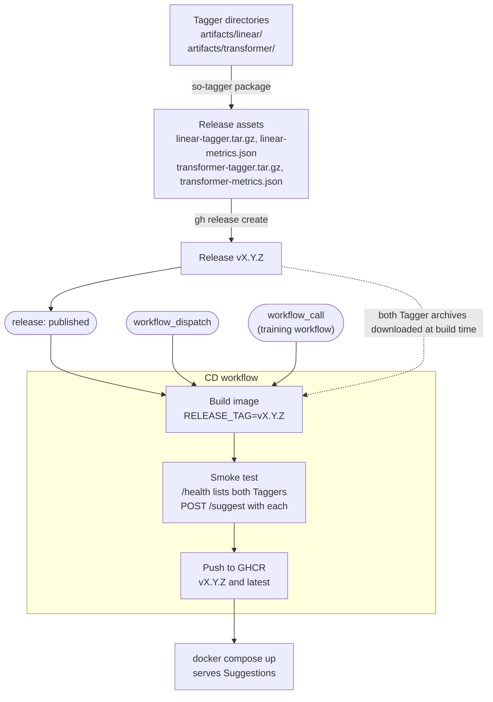
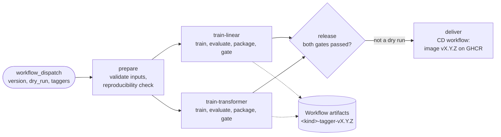

# StackOverflow Tag Prediction

Given the Title of a StackOverflow Question, this project returns a ranked Suggestion list of
Tags with their Scores. Two Taggers are trained on historical tagged Questions: a Linear tagger
built on classic machine learning, and a Transformer tagger built on a fine-tuned pretrained
language model. See the [glossary](GLOSSARY.md) for the exact meaning of these terms and the
[spec issue #2](https://github.com/thomas-hinton/stackoverflow-tag-prediction/issues/2) for the
full scope.

## Setup

Requires [uv](https://docs.astral.sh/uv/). uv installs Python 3.12 if it is missing.

```bash
uv sync            # create .venv with the package and the dev tooling
uv run so-tagger --help
uv run so-tagger --version
```

Use `uv sync --frozen` to install exactly what `uv.lock` pins (this is what CI does).

The Transformer tagger needs the `transformer` extra (CPU-only PyTorch and Hugging Face
`transformers`, about 1 GB). The base install leaves it out so that the Linear tagger stays light:

```bash
uv sync --extra transformer
```

Settings shared by the pipeline, such as the seed, the Supported tag frequency cut-off, the
split ratios and both Taggers' hyperparameters, live in the versioned
[`config.toml`](config.toml).

## Quickstart (CLI)

From a fresh clone, after `uv sync`:

```bash
uv run so-tagger prepare                  # raw CSV -> data/prepared/ (Questions with Supported tags)
uv run so-tagger split                    # -> data/splits/{train,validation,test}.jsonl
uv run so-tagger train --tagger linear    # -> artifacts/linear/ (model + metadata.json)
uv run so-tagger suggest "How do I parse JSON in Python?"
uv run so-tagger evaluate                 # -> metrics/linear-test.json

# Transformer tagger (needs `uv sync --extra transformer`; about 25 minutes on a laptop CPU)
uv run so-tagger train --tagger transformer      # -> artifacts/transformer/
uv run so-tagger evaluate --tagger transformer   # -> metrics/transformer-test.json
uv run so-tagger suggest --tagger transformer "How do I parse JSON in Python?"
```

```text
Tag     Score
python  1.000
json    0.990
```

`train` tunes the Score cut-off on the validation split and saves it with the Tagger; `evaluate`
measures the Tagger on the test split and writes a metrics file. The tuning rule and the metrics
file schema are documented in [docs/metrics.md](docs/metrics.md). Results on the test split:

| Tagger | micro-F1 | macro-F1 | P@1 | P@3 | R@5 | Training |
| --- | --- | --- | --- | --- | --- | --- |
| Linear | 0.509 | 0.463 | 0.611 | 0.306 | 0.694 | 10 s |
| Transformer | 0.509 | 0.359 | 0.605 | 0.315 | 0.710 | 25 min |

The Transformer tagger fine-tunes DistilBERT on CPU ([ADR 0001](docs/adr/0001-distilbert-fine-tuned-on-cpu.md)):
it sets its maximum sequence length from the training Titles, evaluates validation micro-F1 after
each epoch and keeps the best epoch, with early stopping. It logs one line per epoch:

```text
Maximum sequence length: 29 tokens (covers the 99th percentile of training Titles).
Epoch 1/10: loss 0.2914, validation micro-F1 0.1320, 151s elapsed.
...
Epoch 10/10: loss 0.0218, validation micro-F1 0.5269, 1479s elapsed.
Kept epoch 10 (validation micro-F1 0.5269).
```

A saved Tagger directory loads offline: it holds the model, the tokenizer and `metadata.json`.

Add `--json` to `suggest` for machine-readable output. Every command has `--help`, takes its
input and output locations as options, and reads its settings from `config.toml` (`--config`
selects another file).

The frozen split in `data/splits/` is committed: it is the reference on which both Taggers are
compared. `split` is stratified on Tags ([ADR 0004](docs/adr/0004-iteratively-stratified-frozen-split.md))
and re-running it with the same configuration reproduces the files byte for byte.

## Run the API locally

`serve` starts an HTTP API on both Taggers saved by `train` (in `artifacts/linear/` and
`artifacts/transformer/` by default), loaded once at startup. The interactive documentation, with
the request and response models and their examples, is at <http://127.0.0.1:8000/docs>.

```bash
uv run so-tagger serve                              # Linear tagger only, without the extra
uv run --extra transformer so-tagger serve          # both Taggers
```

```bash
curl -s -X POST http://127.0.0.1:8000/suggest \
  -H 'Content-Type: application/json' \
  -d '{"title": "How do I parse JSON in Python?"}'
```

```json
{
  "tagger": "linear",
  "version": "dev",
  "suggestions": [
    {"tag": "python", "score": 0.9997604176236493},
    {"tag": "json", "score": 0.9902810532193043}
  ]
}
```


*`/docs` with `POST /suggest` expanded: the request body schema shows `tagger` accepts `linear` (default) or `transformer`, then each response with its example.*

- **`POST /suggest`** takes a `title` and an optional `tagger` (`linear` by default). It returns 1
  to 5 Suggestions by descending Score, from the Suggestion policy at the Tagger's tuned Score
  cut-off. `version` is the Release tag the Tagger was packaged for (see
  [Releases](#releases)), or `dev` for a Tagger fresh from `train`.
- **422** for an empty or whitespace-only Title, a Title longer than 300 characters (after
  stripping), or an unknown `tagger`; the message lists the valid names.
- **`"tagger": "transformer"`** asks the Transformer tagger instead; the response says which
  Tagger answered.
- **503** for a known Tagger that is not loaded, e.g. `transformer` when its directory is
  missing.
- **`GET /health`** lists every Tagger kind with `loaded`, `version` (`null` when not loaded) and
  `n_supported_tags`. It returns 200 when the Linear tagger is loaded and 503 otherwise.

| Option | Environment variable | Default |
| --- | --- | --- |
| `--host` | `SO_TAGGER_HOST` | `127.0.0.1` |
| `--port` | `SO_TAGGER_PORT` | `8000` |
| `--linear-dir` | `SO_TAGGER_LINEAR_DIR` | `artifacts/linear` |
| `--transformer-dir` | `SO_TAGGER_TRANSFORMER_DIR` | `artifacts/transformer` |
| `--torch-threads` | `SO_TAGGER_TORCH_THREADS` | `0` (PyTorch's default) |

A missing Tagger directory does not stop the server: that Tagger is reported as not loaded.
The Transformer tagger serves in eval mode with gradients disabled; requests are handled
concurrently, and its tokenizer, which is not thread-safe, is called under a lock.
Each `POST /suggest` logs one JSON line with the Tagger and its version, the Title length, the
number of Suggestions and the latency, so that the latency of the two Taggers can be compared.
Titles themselves are only logged at debug level.

## Run with Docker

Each Release has a Docker image on GitHub Container Registry with both Taggers built in. On a
machine with only Docker, from a clone of the repository (or with just
[`compose.yaml`](compose.yaml)):

```bash
docker compose up                        # pulls ghcr.io/thomas-hinton/stackoverflow-tag-prediction:latest
```

```bash
curl -s -X POST http://127.0.0.1:8000/suggest \
  -H 'Content-Type: application/json' \
  -d '{"title": "How do I parse JSON in Python?"}'
```

```json
{"tagger": "linear", "version": "v0.3.0", "suggestions": [{"tag": "python", "score": 0.9997604176236493}, {"tag": "json", "score": 0.9902810532193043}]}
```

Add `"tagger": "transformer"` to the body to ask the Transformer tagger.

`SO_TAGGER_IMAGE_TAG=v0.3.0 docker compose up` runs a given Release instead of the latest one,
`SO_TAGGER_PORT` changes the port on the host, and `SO_TAGGER_TORCH_THREADS` caps the CPU
threads of the Transformer tagger. The service restarts unless stopped, and Docker marks it
healthy once `GET /health` returns 200.

Measured on an image built locally from the `v0.3.0` Tagger archives (Docker 29, WSL 2 on a
laptop CPU), with the network disabled (`--network none`):

| Measure | Value |
| --- | --- |
| Image size | 1.53 GB uncompressed, about 0.6 GB to download |
| Memory at idle, both Taggers loaded | about 360 MiB |
| Memory under load (16 concurrent clients, both Taggers) | about 400 MiB |
| Cold start (`docker run` to `/health` answering 200) | about 7.4 s |
| Latency per request, alone | about 20 ms (Linear), about 25 ms (Transformer) |

The recommended memory limit is **1 GiB**: [`compose.yaml`](compose.yaml) sets it, leaving room
for longer Titles and bursts. PyTorch accounts for most of the image (about 0.8 GB of the
1.11 GB virtual environment), the Transformer tagger for 0.28 GB.

To build the image yourself from a Release instead of pulling it:

```bash
RELEASE_TAG=v0.3.0 docker compose -f compose.yaml -f compose.build.yaml up --build
# or, without Compose:
docker build --build-arg RELEASE_TAG=v0.3.0 -t so-tagger:v0.3.0 .
```

The [`Dockerfile`](Dockerfile) is a multi-stage build on a slim Python 3.12 base. It installs the
runtime dependencies with the `transformer` extra (`uv sync --frozen --no-dev --extra
transformer`), whose PyTorch comes from the CPU wheel index only, and drops the third-party test
suites and torch's C++ headers. It downloads both Tagger archives of the Release given by
`RELEASE_TAG` at build time, and the build fails with the missing URL when the Release lacks
one. The final stage holds no build tool, no cache, no test and no notebook. The image sets the
Hugging Face offline variables (`HF_HUB_OFFLINE`, `TRANSFORMERS_OFFLINE`), so the container
never reaches the network at runtime, and runs `so-tagger serve` as a non-root user on port
8000. It carries a `HEALTHCHECK` on `/health` and OCI labels for the source repository, the
Release version and the commit.

## Releases

Trained Taggers are published as GitHub Release assets, not committed
([ADR 0002](docs/adr/0002-github-releases-for-model-artifacts.md)). Publishing a Release
builds, smoke-tests and pushes its Docker image.



*Look at the dashed arrow: the image never contains a Tagger from the repository; whichever of
the three triggers starts the CD workflow, the build downloads both Tagger archives from the
Release.*

### Release asset convention

- Release tags follow semantic versioning: `vMAJOR.MINOR.PATCH` (e.g. `v0.1.0`).
- For each Tagger kind it carries, a Release has two assets:
  - `<kind>-tagger.tar.gz`: the Tagger directory, its files at the archive root;
  - `<kind>-metrics.json`: the [metrics file](docs/metrics.md) of that Tagger on the test split.

  The Docker image needs both `linear-tagger.tar.gz` and `transformer-tagger.tar.gz`.

`package` builds these assets from a Tagger directory. It writes the Release tag into the
archived `metadata.json` as the Tagger's `version`, which `/health` and `/suggest` report; the
Tagger directory itself is left untouched.

```bash
uv run so-tagger package --release-tag v0.3.0 --metrics metrics/linear-test.json
# -> dist/linear-tagger.tar.gz and dist/linear-metrics.json
uv run --extra transformer so-tagger package --release-tag v0.3.0 --tagger transformer \
  --metrics metrics/transformer-test.json
# -> dist/transformer-tagger.tar.gz and dist/transformer-metrics.json
```

### Continuous delivery

The [CD workflow](.github/workflows/cd.yml) builds the image of a Release, starts it, checks
that `/health` answers 200 and lists both Taggers as loaded with the Release tag, and that
`POST /suggest` returns at least one Suggestion from each Tagger, then pushes
`ghcr.io/thomas-hinton/stackoverflow-tag-prediction` with the tags `vX.Y.Z` and `latest`. It
runs:

- on `release: published`, when a Release is published by hand;
- on `workflow_dispatch` with a `release_tag` input, to rebuild the image of an existing Release
  (`gh workflow run cd.yml -f release_tag=v0.1.0`);
- on `workflow_call` with a `release_tag` input. A Release created inside another workflow with
  the default `GITHUB_TOKEN` triggers no `release` event, so the training workflow calls this
  one explicitly.

The image is built from the code at the Release tag. Rebuilding an older Release moves `latest`
back to it.

### Manual release (fallback)

Releases are normally published by the [training workflow](#training-and-releasing). Whenever it
cannot run, a Release is made by hand from a clone on `main`:

```bash
uv sync --extra transformer
uv run so-tagger train                    # artifacts/linear/
uv run so-tagger evaluate                 # metrics/linear-test.json
uv run so-tagger train --tagger transformer      # artifacts/transformer/, about 25 minutes
uv run so-tagger evaluate --tagger transformer   # metrics/transformer-test.json
uv run so-tagger package --release-tag v0.3.0 --metrics metrics/linear-test.json
uv run so-tagger package --release-tag v0.3.0 --tagger transformer \
  --metrics metrics/transformer-test.json
uv run so-tagger release-notes --metrics metrics/linear-test.json \
  --metrics metrics/transformer-test.json > release-notes.md
gh release create v0.3.0 dist/linear-tagger.tar.gz dist/linear-metrics.json \
  dist/transformer-tagger.tar.gz dist/transformer-metrics.json \
  --target main --prerelease --title v0.3.0 --notes-file release-notes.md
```

Publishing the Release starts the CD workflow; follow it with `gh run watch`. The workflow
pushes the image with the repository's `GITHUB_TOKEN`, and the image's
`org.opencontainers.image.source` label points at the repository. The GHCR package is therefore
linked to the repository and inherits its public visibility: `docker compose up` pulls the
image without `docker login`, and no step on GHCR is needed. If the pull fails with
`unauthorized` or `denied`, check the visibility in the package settings on GitHub.

## Training and releasing

The [CT workflow](.github/workflows/ct.yml) trains both Taggers on GitHub-hosted runners, gates
each one against its own floor and publishes them together as one Release. Nothing depends on
the maintainer's laptop, and every published Tagger is traceable to a commit and its metrics.
Trigger it in the evening from **Actions → CT → Run workflow**, or:

```bash
gh workflow run ct.yml -f version=0.2.0                      # train, gate, release v0.2.0, build its image
gh workflow run ct.yml -f version=0.2.0 -f dry_run=true      # same, without the Release and the image
gh workflow run ct.yml -f version=0.2.0 -f taggers=linear    # debug one Tagger: always a dry run
gh run watch
```

| Input | Meaning |
| --- | --- |
| `version` | Required. The version to release, `MAJOR.MINOR.PATCH` without the `v` (e.g. `0.2.0`); the Release is tagged `v0.2.0`. The run fails at once if it is not semantic versioning or if the tag or Release already exists. |
| `dry_run` | Default `false`. When `true`, every job runs, Release notes included, except creating the Release, so the CD workflow does not run either. Use it to try a change before releasing it. |
| `taggers` | Default `both`. `linear` or `transformer` trains that Tagger only, to debug it without waiting for the other. A Release always holds both Taggers, so any value but `both` **forces a dry run**, whatever `dry_run` says. |

The next morning, the run has one of two outcomes:

- **success**: a Release `vX.Y.Z` with `linear-tagger.tar.gz`, `linear-metrics.json`,
  `transformer-tagger.tar.gz` and `transformer-metrics.json`, and the image `vX.Y.Z` on GHCR;
- **failure**: the job summary names the Tagger that fell below its floor, or the job that
  failed, and nothing is published.

### Job graph



*The two training jobs run side by side; the release job waits for both and runs only when both
passed their gate, and the image is built only from a published Release.*

1. **prepare** validates the inputs (semantic versioning, `main` unless a dry run, tag and
   Release not taken), then regenerates the split from the committed raw dataset and
   `config.toml` with `prepare` and `split`: the run fails if `data/splits/` differs from the
   committed files.
2. **train-linear** and **train-transformer** run in parallel. Each one trains its Tagger,
   evaluates it on the test split, packages the Release assets and runs the quality gate:
   `so-tagger gate` compares the test micro-F1 with the floor of the Tagger kind in
   `[quality_gate.min_test_micro_f1]` of `config.toml`. Both floors (0.20) are provisional and
   deliberately low, so that they only catch a broken Tagger; #13 sets them from real scores.
   One Tagger failing does not stop the other, so every run gives both verdicts.
3. **release** runs only when both training jobs succeeded. It downloads both workflow
   artifacts, writes the Release notes with `so-tagger release-notes` (a side-by-side table of
   both Taggers' test metrics, Score cut-offs and training times, then the frequency cut-off,
   the dataset sizes, the commit and a link to the run) and, unless the run is a dry run,
   creates the Release from `main` with the four assets.
4. **deliver** calls the [CD workflow](#continuous-delivery), which builds, smoke-tests and
   pushes the image `vX.Y.Z` and `latest` to GHCR.
5. **summary** always runs last: its job summary shows both Taggers' headline metrics, their
   gate results and the Release link.

The **train-transformer** job fine-tunes DistilBERT on CPU, so it is long. It has a 330-minute
timeout, within GitHub's 6-hour job limit. It caches the `uv` environment and the Hugging Face
checkpoint between runs. It gives PyTorch one thread per physical core of the runner through
`SO_TAGGER_TORCH_THREADS`, the environment variable of `train --torch-threads`: on a 4-vCPU
runner with 2 cores, an epoch takes 98 s on 2 threads and 168 s on 4. It logs its progress every
50 steps and after every epoch, so the run can be followed live with `gh run watch` or in the
job log.

| Job | Expected duration on a GitHub-hosted runner (measured on the first dry runs) |
| --- | --- |
| prepare | about 20 s |
| train-linear | about 20 s |
| train-transformer | about 17 min (10 epochs of 180 steps, about 100 s each) |
| release, summary | about 20 s |
| deliver (CD) | about 2 to 4 min |

### Reading a failed run

Open the run's **summary**. Its table has one row per Tagger:

- `Quality gate failed for the transformer Tagger: test micro-F1 0.1234 is below the floor
  0.2000 (difference -0.0766).` means that Tagger trained correctly but scored below its floor.
  The release job is skipped, so nothing is published. Download its workflow artifact
  (`transformer-tagger-vX.Y.Z`: the packaged Tagger, its metrics file and the gate result) to
  inspect it, then fix the Tagger or, if the floor is wrong, the floor in `config.toml`.
- `not reached: see the failed step` or `not run, or stopped before evaluation` means a job
  failed before the gate (training error, timeout): open that job's log.
- If **prepare** failed, no Tagger was trained: the inputs were rejected or the split is not
  reproducible, and the error annotation says which.

Whatever the outcome, each training job uploads what it produced as a workflow artifact named
`<kind>-tagger-vX.Y.Z`. Published Releases appear on the
[Releases page](https://github.com/thomas-hinton/stackoverflow-tag-prediction/releases) and
their images on the GHCR package of the repository.

Only one training run executes at a time: a second run waits for the first to finish. When the
workflow cannot run, use the [manual release](#manual-release-fallback).

The gate and the notes also run locally:

```bash
uv run so-tagger gate                     # checks metrics/linear-test.json; exit code 1 below the floor
uv run so-tagger gate --tagger transformer
uv run so-tagger release-notes --metrics metrics/linear-test.json --metrics metrics/transformer-test.json
```

## Data exploration

The [exploration notebook](notebooks/01_data_exploration.ipynb) checks the dataset's integrity
and justifies the Supported tag cut-off. Its libraries live in a separate `explore` dependency
group that the runtime install never pulls:

```bash
uv sync --group explore
uv run jupyter lab notebooks/
```

## Running the checks

Type checking covers the `docs-screenshots` command, so install the `docs` group first, as CI does:
`uv sync --extra transformer --group docs`.

```bash
uv run ruff check .            # lint (notebooks included)
uv run ruff format --check .   # formatting
uv run mypy                    # strict type checking
uv run pytest                  # tests with coverage
uv run pytest -m "not slow"    # skip heavy tests (CI does)
```

The HTTP API suite drives the app in process, on a small Linear tagger trained on the fixture
dataset. The Tagger contract suite runs against both Taggers; the Transformer tagger uses a tiny
randomly initialised DistilBERT built in the test, so no checkpoint is downloaded. The
`slow` tests fine-tune the real `distilbert-base-uncased` checkpoint and run `docs-screenshots`
in a real browser (it needs the `docs` group and Chromium, see
[Documentation screenshots](#documentation-screenshots)).

CI runs the same commands on every pull request to `main` and on every push to `main`, and
lints the `Dockerfile` with [hadolint](https://github.com/hadolint/hadolint). It installs the
`docs` group too, without a browser, so that the capture list and the server helper of
`docs-screenshots` are type-checked and tested.

## Contributing

- **Branches** are named `<type>/<issue-number>-<slug>`, e.g. `feat/7-linear-tagger`.
- **Commits** and pull request titles follow [Conventional Commits](https://www.conventionalcommits.org/)
  (`feat:`, `fix:`, `docs:`, `chore:`, ...).
- **One pull request per sub-issue**, and its description closes that issue with `Closes #N`.
- **Squash merge** only; head branches are deleted after merge.
- All repository content is written in English.

### Documentation screenshots

Every screenshot in the docs is regenerated by one command, never captured by hand. Captures are
declared in [`docs/screenshots.toml`](docs/screenshots.toml), whose header documents each field.
Playwright and Pillow live in a separate `docs` dependency
group that the runtime install and the Docker image never pull. Install them and Chromium once, then run the
command from the repository root:

```bash
uv sync --group docs
uv run --group docs playwright install chromium   # one-time browser download
```

```bash
uv run --group docs docs-screenshots              # regenerate every capture
uv run --group docs docs-screenshots --only api-docs-suggest
uv run --group docs docs-screenshots --list       # show the declared captures
uv run --group docs docs-screenshots --check      # report PNGs no capture declares
```

The command trains a small Linear tagger on the fixture dataset (a few seconds), serves the API
on a free local port, captures each page in headless Chromium with fixed settings (viewport,
scale 1, light theme, animations off), and writes optimised PNGs to `docs/images/screenshots/`.
It fails, and deletes the image, if one exceeds 300 KB; it always stops the server. Swagger UI loads its scripts
from a CDN, so the command needs network access. Agents follow
[`docs/agents/illustrations.md`](docs/agents/illustrations.md).

### Why required approvals are 0

`main` is protected: changes land only through a pull request, the `ci` check must pass on a
branch that is up to date with `main`, and force pushes and deletions are blocked. Required
approvals are set to 0 because the project has a single maintainer and GitHub does not let
authors approve their own pull requests; requiring an approval would block every merge. Review
still happens on every pull request: the author posts a self-review comment before merging.

## Design records

- [Glossary](GLOSSARY.md): the domain language used in code, docs and issues.
- [Score cut-off tuning and the metrics file](docs/metrics.md).
- Architecture decisions:
  - [ADR 0001: DistilBERT fine-tuned on CPU](docs/adr/0001-distilbert-fine-tuned-on-cpu.md)
  - [ADR 0002: GitHub Releases for model artifacts](docs/adr/0002-github-releases-for-model-artifacts.md)
  - [ADR 0003: Supported tag frequency cut-off](docs/adr/0003-supported-tag-frequency-cutoff.md)
  - [ADR 0004: Iteratively stratified frozen split](docs/adr/0004-iteratively-stratified-frozen-split.md)
