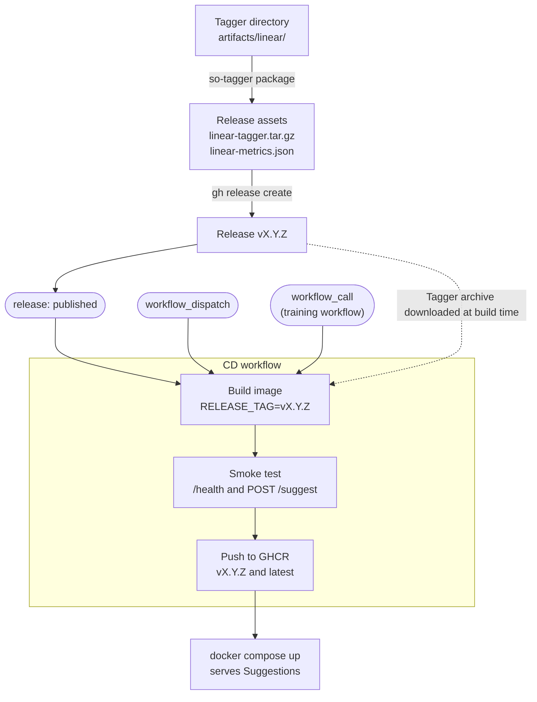
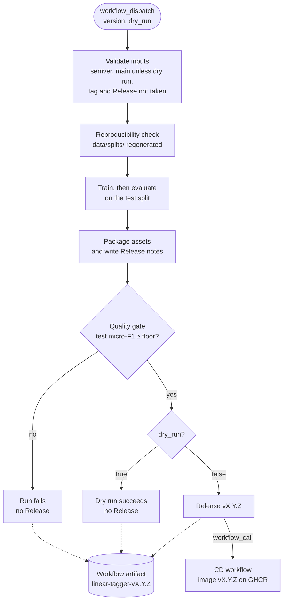

# StackOverflow Tag Prediction

Given the Title of a StackOverflow Question, this project returns a ranked Suggestion list of
Tags with their Scores. Two Taggers are trained on historical tagged Questions: a Linear tagger
built on classic machine learning, and a Transformer tagger built on a fine-tuned pretrained
language model. See the [glossary](GLOSSARY.md) for the exact meaning of these terms and the
[spec issue #2](https://github.com/thomas-hinton/stackoverflow-tag-prediction/issues/2) for the
full scope.

## Setup

Requires [uv](https://docs.astral.sh/uv/). uv installs Python 3.12 if it is missing.

```bash
uv sync            # create .venv with the package and the dev tooling
uv run so-tagger --help
uv run so-tagger --version
```

Use `uv sync --frozen` to install exactly what `uv.lock` pins (this is what CI does).

The Transformer tagger needs the `transformer` extra (CPU-only PyTorch and Hugging Face
`transformers`, about 1 GB). The base install leaves it out so that the Linear tagger stays light:

```bash
uv sync --extra transformer
```

Settings shared by the pipeline, such as the seed, the Supported tag frequency cut-off, the
split ratios and both Taggers' hyperparameters, live in the versioned
[`config.toml`](config.toml).

## Quickstart (CLI)

From a fresh clone, after `uv sync`:

```bash
uv run so-tagger prepare                  # raw CSV -> data/prepared/ (Questions with Supported tags)
uv run so-tagger split                    # -> data/splits/{train,validation,test}.jsonl
uv run so-tagger train --tagger linear    # -> artifacts/linear/ (model + metadata.json)
uv run so-tagger suggest "How do I parse JSON in Python?"
uv run so-tagger evaluate                 # -> metrics/linear-test.json

# Transformer tagger (needs `uv sync --extra transformer`; about 25 minutes on a laptop CPU)
uv run so-tagger train --tagger transformer      # -> artifacts/transformer/
uv run so-tagger evaluate --tagger transformer   # -> metrics/transformer-test.json
uv run so-tagger suggest --tagger transformer "How do I parse JSON in Python?"
```

```text
Tag     Score
python  1.000
json    0.990
```

`train` tunes the Score cut-off on the validation split and saves it with the Tagger; `evaluate`
measures the Tagger on the test split and writes a metrics file. The tuning rule and the metrics
file schema are documented in [docs/metrics.md](docs/metrics.md). Results on the test split:

| Tagger | micro-F1 | macro-F1 | P@1 | P@3 | R@5 | Training |
| --- | --- | --- | --- | --- | --- | --- |
| Linear | 0.509 | 0.463 | 0.611 | 0.306 | 0.694 | 10 s |
| Transformer | 0.509 | 0.359 | 0.605 | 0.315 | 0.710 | 25 min |

The Transformer tagger fine-tunes DistilBERT on CPU ([ADR 0001](docs/adr/0001-distilbert-fine-tuned-on-cpu.md)):
it sets its maximum sequence length from the training Titles, evaluates validation micro-F1 after
each epoch and keeps the best epoch, with early stopping. It logs one line per epoch:

```text
Maximum sequence length: 29 tokens (covers the 99th percentile of training Titles).
Epoch 1/10: loss 0.2914, validation micro-F1 0.1320, 151s elapsed.
...
Epoch 10/10: loss 0.0218, validation micro-F1 0.5269, 1479s elapsed.
Kept epoch 10 (validation micro-F1 0.5269).
```

A saved Tagger directory loads offline: it holds the model, the tokenizer and `metadata.json`.

Add `--json` to `suggest` for machine-readable output. Every command has `--help`, takes its
input and output locations as options, and reads its settings from `config.toml` (`--config`
selects another file).

The frozen split in `data/splits/` is committed: it is the reference on which both Taggers are
compared. `split` is stratified on Tags ([ADR 0004](docs/adr/0004-iteratively-stratified-frozen-split.md))
and re-running it with the same configuration reproduces the files byte for byte.

## Run the API locally

`serve` starts an HTTP API on the Linear tagger saved by `train` (in `artifacts/linear/` by
default). The interactive documentation, with the request and response models and their
examples, is at <http://127.0.0.1:8000/docs>.

```bash
uv run so-tagger serve                    # http://127.0.0.1:8000
```

```bash
curl -s -X POST http://127.0.0.1:8000/suggest \
  -H 'Content-Type: application/json' \
  -d '{"title": "How do I parse JSON in Python?"}'
```

```json
{
  "tagger": "linear",
  "version": "dev",
  "suggestions": [
    {"tag": "python", "score": 0.9997604176236493},
    {"tag": "json", "score": 0.9902810532193043}
  ]
}
```

<!-- Interactive docs screenshot: generated and embedded by the `docs-screenshots` command (#16). -->

- **`POST /suggest`** takes a `title` and an optional `tagger` (`linear` by default). It returns 1
  to 5 Suggestions by descending Score, from the Suggestion policy at the Tagger's tuned Score
  cut-off. `version` is the Release tag the Tagger was packaged for (see
  [Releases](#releases)), or `dev` for a Tagger fresh from `train`.
- **422** for an empty or whitespace-only Title, a Title longer than 300 characters (after
  stripping), or an unknown `tagger`; the message lists the valid names.
- **503** for a known Tagger that is not loaded: `transformer` is not served yet (#11).
- **`GET /health`** lists every Tagger kind with `loaded`, `version` (`null` when not loaded) and
  `n_supported_tags`. It returns 200 when the Linear tagger is loaded and 503 otherwise.

| Option | Environment variable | Default |
| --- | --- | --- |
| `--host` | `SO_TAGGER_HOST` | `127.0.0.1` |
| `--port` | `SO_TAGGER_PORT` | `8000` |
| `--linear-dir` | `SO_TAGGER_LINEAR_DIR` | `artifacts/linear` |

A missing Tagger directory does not stop the server: that Tagger is reported as not loaded.
Each `POST /suggest` logs one JSON line with the Tagger, the Title length, the number of
Suggestions and the latency. Titles themselves are only logged at debug level.

## Run with Docker

Each Release has a Docker image on GitHub Container Registry with its Taggers built in. On a
machine with only Docker, from a clone of the repository (or with just
[`compose.yaml`](compose.yaml)):

```bash
docker compose up                        # pulls ghcr.io/thomas-hinton/stackoverflow-tag-prediction:latest
```

```bash
curl -s -X POST http://127.0.0.1:8000/suggest \
  -H 'Content-Type: application/json' \
  -d '{"title": "How do I parse JSON in Python?"}'
```

```json
{"tagger": "linear", "version": "v0.1.0", "suggestions": [{"tag": "python", "score": 0.9997604176236493}, {"tag": "json", "score": 0.9902810532193043}]}
```

`SO_TAGGER_IMAGE_TAG=v0.1.0 docker compose up` runs a given Release instead of the latest one,
and `SO_TAGGER_PORT` changes the port on the host. The service restarts unless stopped, and
Docker marks it healthy once `GET /health` returns 200.

To build the image yourself from a Release instead of pulling it:

```bash
RELEASE_TAG=v0.1.0 docker compose -f compose.yaml -f compose.build.yaml up --build
# or, without Compose:
docker build --build-arg RELEASE_TAG=v0.1.0 -t so-tagger:v0.1.0 .
```

The [`Dockerfile`](Dockerfile) installs the runtime dependencies only (`uv sync --frozen
--no-dev`, no deep-learning stack) on a slim Python 3.12 base, downloads the Tagger archive of
the Release given by `RELEASE_TAG` at build time, and runs `so-tagger serve` as a non-root user
on port 8000. It carries a `HEALTHCHECK` on `/health` and OCI labels for the source repository,
the Release version and the commit.

## Releases

Trained Taggers are published as GitHub Release assets, not committed
([ADR 0002](docs/adr/0002-github-releases-for-model-artifacts.md)). Publishing a Release
builds, smoke-tests and pushes its Docker image.



*Look at the dashed arrow: the image never contains a Tagger from the repository; whichever of
the three triggers starts the CD workflow, the build downloads the Tagger archive from the Release.*

### Release asset convention

- Release tags follow semantic versioning: `vMAJOR.MINOR.PATCH` (e.g. `v0.1.0`).
- For each Tagger kind it carries, a Release has two assets:
  - `<kind>-tagger.tar.gz`: the Tagger directory, its files at the archive root;
  - `<kind>-metrics.json`: the [metrics file](docs/metrics.md) of that Tagger on the test split.

  For now only `linear-tagger.tar.gz` and `linear-metrics.json` exist; the Transformer tagger
  adds `transformer-*` assets.

`package` builds these assets from a Tagger directory. It writes the Release tag into the
archived `metadata.json` as the Tagger's `version`, which `/health` and `/suggest` report; the
Tagger directory itself is left untouched.

```bash
uv run so-tagger package --release-tag v0.1.0 --metrics metrics/linear-test.json
# -> dist/linear-tagger.tar.gz and dist/linear-metrics.json
```

### Continuous delivery

The [CD workflow](.github/workflows/cd.yml) builds the image of a Release, starts it, checks
that `/health` answers 200 with the Release tag and that `POST /suggest` returns at least one
Suggestion, then pushes `ghcr.io/thomas-hinton/stackoverflow-tag-prediction` with the tags
`vX.Y.Z` and `latest`. It runs:

- on `release: published`, when a Release is published by hand;
- on `workflow_dispatch` with a `release_tag` input, to rebuild the image of an existing Release
  (`gh workflow run cd.yml -f release_tag=v0.1.0`);
- on `workflow_call` with a `release_tag` input. A Release created inside another workflow with
  the default `GITHUB_TOKEN` triggers no `release` event, so the training workflow calls this
  one explicitly.

The image is built from the code at the Release tag. Rebuilding an older Release moves `latest`
back to it.

### Manual release (fallback)

Releases are normally published by the [training workflow](#training-and-releasing). Whenever it
cannot run, a Release is made by hand from a clone on `main`:

```bash
uv run so-tagger train                    # artifacts/linear/
uv run so-tagger evaluate                 # metrics/linear-test.json
uv run so-tagger package --release-tag v0.1.0 --metrics metrics/linear-test.json
gh release create v0.1.0 dist/linear-tagger.tar.gz dist/linear-metrics.json \
  --target main --prerelease --title v0.1.0 --notes "Linear tagger trained by hand."
```

Publishing the Release starts the CD workflow; follow it with `gh run watch`. The workflow
pushes the image with the repository's `GITHUB_TOKEN`, and the image's
`org.opencontainers.image.source` label points at the repository. The GHCR package is therefore
linked to the repository and inherits its public visibility: `docker compose up` pulls the
image without `docker login`, and no step on GHCR is needed. If the pull fails with
`unauthorized` or `denied`, check the visibility in the package settings on GitHub.

## Training and releasing

The [CT workflow](.github/workflows/ct.yml) trains the Linear tagger on a GitHub-hosted runner
and publishes it. Nothing depends on the maintainer's laptop, and every published Tagger is
traceable to a commit and its metrics. Trigger it from **Actions → CT → Run workflow**, or:

```bash
gh workflow run ct.yml -f version=0.2.0                 # train, gate, release v0.2.0, build its image
gh workflow run ct.yml -f version=0.2.0 -f dry_run=true # same, without the Release and the image
gh run watch
```

| Input | Meaning |
| --- | --- |
| `version` | Required. The version to release, `MAJOR.MINOR.PATCH` without the `v` (e.g. `0.2.0`); the Release is tagged `v0.2.0`. The run fails at once if it is not semantic versioning or if the tag or Release already exists. |
| `dry_run` | Default `false`. When `true`, every step runs except creating the Release, so the CD workflow does not run either. Use it to try a change before releasing it. |

A run goes through these steps and stops at the first failure:

1. **Reproducibility check**: `prepare` and `split` regenerate the split from the committed raw
   dataset and `config.toml`; the run fails if `data/splits/` differs from the committed files.
2. **Train** the Linear tagger and **evaluate** it on the test split.
3. **Package** the Release assets (`linear-tagger.tar.gz`, `linear-metrics.json`).
4. **Quality gate**: `so-tagger gate` compares the test micro-F1 with the floor of the Tagger kind
   in `[quality_gate.min_test_micro_f1]` of `config.toml`, and fails below it with the value, the
   floor and the difference. The current floor (0.20) is provisional and deliberately low, so
   that it only catches a broken Tagger; #13 sets it from real scores.
5. **Release** `vX.Y.Z` from `main` with both assets and notes generated by
   `so-tagger release-notes` from the metrics file: the metrics table, the Score cut-off, the
   frequency cut-off, the dataset sizes, the commit and a link to the run.
6. **CD**: the workflow calls the [CD workflow](#continuous-delivery), which builds, smoke-tests
   and pushes the image `vX.Y.Z` and `latest` to GHCR.



*Look at the two decisions after packaging: only a Tagger that passes the gate in a run that is
not a dry run becomes a Release and an image, yet every outcome leaves the workflow artifact.*

Whatever the outcome, the run uploads the packaged Tagger, its metrics file, the Release notes
and the gate result as a workflow artifact named `linear-tagger-vX.Y.Z`, so that a Tagger
rejected by the gate can still be downloaded and inspected. The job summary shows the gate
result, whether a Release was created, and the metrics table. Published Releases appear on the
[Releases page](https://github.com/thomas-hinton/stackoverflow-tag-prediction/releases) and
their images on the GHCR package of the repository.

Only one training run executes at a time: a second run waits for the first to finish. Releases
are only created from `main`; a dry run may target another branch. When the workflow cannot run,
use the [manual release](#manual-release-fallback).

The gate and the notes also run locally:

```bash
uv run so-tagger gate                     # checks metrics/linear-test.json; exit code 1 below the floor
uv run so-tagger release-notes --metrics metrics/linear-test.json
```

## Data exploration

The [exploration notebook](notebooks/01_data_exploration.ipynb) checks the dataset's integrity
and justifies the Supported tag cut-off. Its libraries live in a separate `explore` dependency
group that the runtime install never pulls:

```bash
uv sync --group explore
uv run jupyter lab notebooks/
```

## Running the checks

```bash
uv run ruff check .            # lint (notebooks included)
uv run ruff format --check .   # formatting
uv run mypy                    # strict type checking
uv run pytest                  # tests with coverage
uv run pytest -m "not slow"    # skip heavy tests (CI does)
```

The HTTP API suite drives the app in process, on a small Linear tagger trained on the fixture
dataset. The Tagger contract suite runs against both Taggers; the Transformer tagger uses a tiny
randomly initialised DistilBERT built in the test, so no checkpoint is downloaded. The only
`slow` test fine-tunes the real `distilbert-base-uncased` checkpoint.

CI runs the same commands on every pull request to `main` and on every push to `main`, and
lints the `Dockerfile` with [hadolint](https://github.com/hadolint/hadolint).

## Contributing

- **Branches** are named `<type>/<issue-number>-<slug>`, e.g. `feat/7-linear-tagger`.
- **Commits** and pull request titles follow [Conventional Commits](https://www.conventionalcommits.org/)
  (`feat:`, `fix:`, `docs:`, `chore:`, ...).
- **One pull request per sub-issue**, and its description closes that issue with `Closes #N`.
- **Squash merge** only; head branches are deleted after merge.
- All repository content is written in English.

### Why required approvals are 0

`main` is protected: changes land only through a pull request, the `ci` check must pass on a
branch that is up to date with `main`, and force pushes and deletions are blocked. Required
approvals are set to 0 because the project has a single maintainer and GitHub does not let
authors approve their own pull requests; requiring an approval would block every merge. Review
still happens on every pull request: the author posts a self-review comment before merging.

## Design records

- [Glossary](GLOSSARY.md): the domain language used in code, docs and issues.
- [Score cut-off tuning and the metrics file](docs/metrics.md).
- Architecture decisions:
  - [ADR 0001: DistilBERT fine-tuned on CPU](docs/adr/0001-distilbert-fine-tuned-on-cpu.md)
  - [ADR 0002: GitHub Releases for model artifacts](docs/adr/0002-github-releases-for-model-artifacts.md)
  - [ADR 0003: Supported tag frequency cut-off](docs/adr/0003-supported-tag-frequency-cutoff.md)
  - [ADR 0004: Iteratively stratified frozen split](docs/adr/0004-iteratively-stratified-frozen-split.md)
