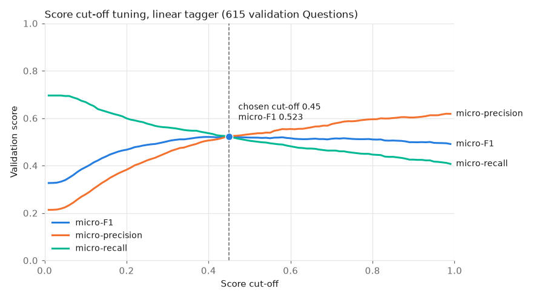

# Score cut-off tuning and the metrics file

How a Tagger's Score cut-off is chosen, and the schema of the metrics file that `evaluate`
writes. The quality gate, the Release workflow and the report rely on this schema: change it
only by bumping `schema_version`.

The quality gate (`so-tagger gate`) reads `metrics.micro_f1` of a test-split metrics file, and
the Release notes (`so-tagger release-notes`) are generated from the same file.

Both steps go through the Tagger contract only (batch Scores, Supported tags, Score cut-off and
the shared Suggestion policy), in `src/so_tagger/evaluation.py`. Every Tagger kind is tuned and
measured the same way.

## Score cut-off tuning

`train` tunes the Score cut-off right after fitting, on the **validation** split:

1. Score every validation Question once.
2. For each candidate cut-off from 0.01 to 0.99 in steps of 0.01, apply the full Suggestion
   policy (cut-off, at least 1, at most 5 Suggestions) and compute micro-F1 against the true
   Supported tags.
3. Keep the cut-off with the highest micro-F1. **Ties go to the smallest cut-off.**



*Look at the dashed line: micro-F1 peaks at 0.45, where precision and recall cross; above it
F1 stays nearly flat because the at-least-1 rule keeps one Suggestion per Question.*
Regenerate with `uv run --group explore python scripts/plot_cutoff_tuning.py`.

The chosen `score_cutoff` and its `validation_micro_f1` are saved in the Tagger's
`metadata.json`, and `suggest` uses that cut-off. The test split is never passed to `train`; a
test proves that `train` gives the same cut-off when `test.jsonl` is replaced with garbage.

## Running an evaluation

```bash
uv run so-tagger evaluate                       # artifacts/linear on the test split
uv run so-tagger evaluate --tagger-dir DIR --split validation --output metrics/val.json
```

The default output is `metrics/<tagger>-<split>.json` (the `metrics/` folder is not committed).

## Metrics file schema (`schema_version` 1)

A single JSON object:

| Key | Type | Meaning |
| --- | --- | --- |
| `schema_version` | int | `1`. Bumped on any breaking change to this schema. |
| `tagger` | string | Tagger kind, e.g. `"linear"`. |
| `split` | string | Split evaluated: `"test"` (default), `"validation"` or `"train"`. |
| `metrics` | object | The measured values, see below. |
| `conventions` | object | Plain-English rules used to compute `metrics` (averaging, zero division, `@k`). |
| `score_cutoff` | float | The Tagger's tuned Score cut-off. |
| `validation_micro_f1` | float | micro-F1 reached by that cut-off on the validation split. |
| `frequency_cutoff` | int | Supported tag frequency cut-off the data was prepared with ([ADR 0003](adr/0003-supported-tag-frequency-cutoff.md)). |
| `n_supported_tags` | int | Number of Supported tags of the Tagger. |
| `split_sizes` | object | Questions per split: `train` and `validation` (from training) plus the evaluated split. |
| `hyperparameters` | object | The Tagger's section of `config.toml` at training time. |
| `seed` | int | The project seed at training time. |
| `training_seconds` | float or null | Wall-clock time of training plus tuning; null when unknown. |
| `training_details` | object | What the Tagger kind recorded about its training beyond the hyperparameters; `{}` for the Linear tagger. For the Transformer tagger: `max_length` (tokens), `best_epoch` (the epoch kept), `epochs_run` and `history` (per epoch: `epoch`, `loss`, `validation_micro_f1`, `elapsed_seconds`). Added without a schema bump: it is a new key, nothing existing changed. |
| `git_commit` | string or null | Commit checked out when `evaluate` ran; null outside a git checkout. |
| `package_version` | string | `so-tagger` version that ran `evaluate`. |
| `tagger_package_version` | string | `so-tagger` version that trained the Tagger. |
| `tagger_created_at` | string | ISO 8601 UTC time the Tagger was trained. |
| `created_at` | string | ISO 8601 UTC time the metrics file was written. |

`metrics` holds:

| Key | Type | Meaning |
| --- | --- | --- |
| `micro_f1`, `micro_precision`, `micro_recall` | float | Over every (Question, Supported tag) decision of the Suggestion lists. |
| `macro_f1` | float | Unweighted mean of the per-Tag F1 over **all** Supported tags. |
| `precision_at_k`, `recall_at_k` | object | Keys `"1"`, `"3"`, `"5"`. On the Score ranking, independent of the cut-off. |
| `mean_suggestions_per_question` | float | Average length of the Suggestion lists, between 1 and 5. |
| `per_tag` | object | One entry per Supported tag: `precision`, `recall`, `f1` (floats) and `support` (int, true Questions in the split). |

Conventions:

- **Predicted Tags** are the Suggestion list at the tuned Score cut-off.
- **Zero division counts as 0**, never as an error: a Tag that is never suggested has precision
  0, and a Tag with no true and no predicted example has F1 0 and still counts in `macro_f1`.
- **P@k** = |top-k ∩ true| / k and **R@k** = |top-k ∩ true| / |true|, each averaged over
  Questions. P@5 stays divided by 5 even when a Question has fewer true Tags.
- True Tags are the Question's Supported tags; every evaluated Question has at least one.

All values are in [0, 1] except `support`, `mean_suggestions_per_question`, sizes, counts and
durations.

## Results on the test split

First run of each Tagger on the frozen split (615 test Questions, 86 Supported tags), with the
default `config.toml`:

| Tagger | Score cut-off (validation micro-F1) | micro-F1 | macro-F1 | P@1 | P@3 | R@5 | Suggestions per Question | Training |
| --- | --- | --- | --- | --- | --- | --- | --- | --- |
| Linear | 0.45 (0.523) | 0.509 | **0.463** | **0.611** | 0.306 | 0.694 | 1.47 | 10 s |
| Transformer | 0.25 (0.527) | 0.509 | 0.359 | 0.605 | **0.315** | **0.710** | 1.33 | 25 min, 10 epochs kept of 10 |

The Transformer tagger ranks Tags slightly better (P@3, R@5) but neglects rare Tags (macro-F1);
its training time is on a 12-thread laptop CPU.


*Look at the last epochs: the Transformer only just passes the Linear tagger at epoch 9 and is
still rising slightly at epoch 10, so the epoch kept is the last one run.*
Regenerate with `uv run --group explore python scripts/plot_training_curve.py`.
